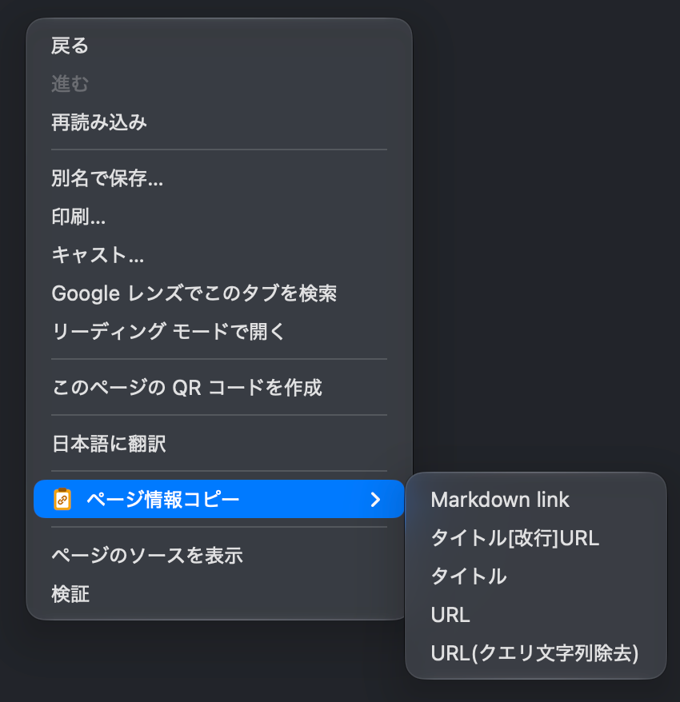

# WebPage Clipboard Tool

## 概要

 WebPage Clipboard Toolは、現在のページのタイトルとURLをさまざまな形式でクリップボードにコピーするためのChrome拡張機能です。  


## 機能

- ページのタイトルとURLをMarkdown形式([タイトル](URL))でコピー
- ページのタイトルとURLを改行で区切ってコピー
- ページのタイトルのみをコピー
- URLのみをコピー
- URLのみをクエリ文字列とフラグメントを除去してコピー

## インストール

1. リポジトリをクローンします:
    ```bash
    git clone https://github.com/foresukecom/webpage-clipboard-tool.git
    ```

2. 拡張機能として読み込むファイルを `dist/extension/` に作成します（[開発環境](#開発環境)が必要です）:
    ```bash
    npm install
    npm run build
    ```

3. Chromeを開き、[chrome://extensions/](chrome://extensions/)にアクセスします。

4. 右上の「デベロッパーモード」を有効にします。

5. 「パッケージ化されていない拡張機能を読み込む」をクリックし、`dist/extension/` ディレクトリを選択します。

リポジトリのディレクトリをそのまま読み込むと、`.direnv/` や `node_modules/` も拡張機能の一部として扱われ、不要なファイルについての警告が出ます。コードを変更したら `npm run build` を実行し、拡張機能を再読み込みしてください。

## スクリーンショット



## 開発環境

開発に必要なツール（Node.js 24 / pnpm / zip）は [Nix](https://nixos.org/) で管理しています。ホストに個別にインストールする必要はありません。

### 前提

- Nix（flakes 有効）
- [direnv](https://direnv.net/) + [nix-direnv](https://github.com/nix-community/nix-direnv)（任意・推奨）

### 使い方

direnv を使う場合は、初回のみ以下を実行すると、以降はディレクトリに入るだけで環境が有効になります。

```bash
direnv allow
```

direnv を使わない場合は、手動でシェルに入ります。

```bash
nix develop
```

ツールを追加・変更する場合は `flake.nix` の `packages` を編集してください。

### テスト

[Playwright](https://playwright.dev/) で、拡張機能を読み込んだ Chromium を起動してテストします。

```bash
npm install   # postinstall で Playwright 用の Chromium も取得されます
npm test
```

右クリックメニューは Playwright から操作できないため、テストではメニュークリック時に呼ばれる `handleMenuClick` を直接実行しています。

### ストア提出用ファイルの作成

```bash
npm run package       # dist/extension/ を作成し、dist/webpage-clipboard-tool-<version>.zip にまとめる
npm run screenshots   # store/*.html から 1280x800 のスクリーンショットを作成
./scripts/generate-icons.sh  # images/icon-source*.svg から icons/ を再生成
```

ストアに登録するアイコンは `icons/icon-128.png`、スクリーンショットは `store/screenshot-1.png` を使います。
